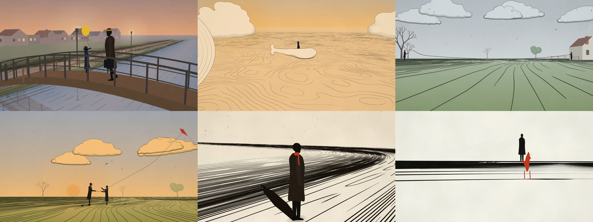

<p align="center"></p>

# Paperlight

**Films from code, in silhouette and light.** A [Claude Code](https://claude.com/claude-code) skill that turns a story
— an idea, a poem, a fable, a screenplay — into a finished short animated film with sound. Ink-silhouette characters
act with posture, gesture and touch in living worlds of real materials, lit by a time of day. Everything is code:
no image or video models.

Ask Claude for a film; it plans the story, builds the world, directs the camera, checks continuity and renders 1080p
with a synthesized score.

## Example films

All five were made with Paperlight. Videos are attached to the [latest release](https://github.com/sudeepkothapalli/paperlight/releases/latest).

| Film | What it shows |
|---|---|
| **The Bridge** | A comedy of manners that turns to kindness on a narrow footbridge at dusk. A balloon and a suitcase change hands; colour passes from a child to a stranger. |
| **A Small Cloud** | A girl falls asleep and befriends a cloud that becomes a rabbit, then a whale. Night room → dream → dawn → morning. |
| **A String Between Us** | A gust carries an old man's kite to a stranger across a wide land. One tug along the string, one wave back, and they wind the distance in. |
| **Desire Path** | Seasons pass; a path forms from footsteps where one person first stepped off the road. |
| **The Fork** | One walker, one choice, one red bird; a world that inks itself in. |

## Install

In Claude Code:

```
/plugin marketplace add sudeepkothapalli/paperlight
/plugin install paperlight@paperlight
```

Then ask: *"Make a Paperlight film about a lighthouse keeper who befriends a gull."*

Requirements: **Node.js 20+** and **ffmpeg** on your PATH. The first time it runs, the skill installs its two npm
dependencies (`@napi-rs/canvas`, `d3-contour`).

Without the plugin system, copy `skills/paperlight` into `~/.claude/skills/paperlight` and run `npm install` there.

## Stories without words

Paperlight films have no dialogue and no faces, so they read the same in every language. The skill builds each film
around a **wordless conversation**: a pull on a shared kite string that travels to the other end and is answered, a
balloon given back, a window lamp switched on in reply, a colour that passes from one person to another.
[`docs/storytelling.md`](skills/paperlight/docs/storytelling.md) sets out the form's strengths, the devices and the
story shapes that suit it.

## What it can do

- **Two looks.** *Living*: real materials (grass, plaster, tiled roofs, wood, iron, water) lit by six times of day,
  plus two dream lights, with light that can change inside a shot. *Classic*: ink lines on toned paper.
- **Characters** of any age and build with personality in their walk, two acting arms, hands that land on things,
  hand shapes, sitting, kneeling, lying, in bed, talking without faces, figures who grow, leap and fly.
- **Figures** are silhouettes in wide shots and ease into tonal garments up close; each can wear one coloured accent
  that means something in the story (a ribbon, a hatband that warms after a kindness).
- **Worlds**: towns, rivers with reflections, bridges, rooms, meadows, seas of cloud, towers, crags, fire;
  passers-by and birds by asking for them; weather; wind; seasons.
- **Objects** that are held, flown, dropped, caught and shared: kites, balloons, suitcases, lanterns, threads.
- **Cinematography and editing**: shot sizes, angles, moves, handheld, POV, depth of field, reveals, dissolves, irises,
  match cuts, cutting on a music track's beats, seamless loops, vertical and square formats.
- **Colour as meaning**: every colour is declared with what it stands for in *this* film and follows story time.
- **Sound**: ambience from the world (wind, birds, river, fire, crickets), footsteps, effects and a melodic score.
- **Checks**: a capability list (`caps`), continuity lint, readability QA, storyboards, colour scripts and model sheets.

## How it works

`skills/paperlight/` holds everything:

| Path | What |
|---|---|
| `SKILL.md` | what Claude reads: capabilities, direction, workflow |
| `engine/` | the renderer (Node, Skia canvas, ffmpeg): terrain, figures, camera, light, sound, checks |
| `templates/` | a starter `film.js` and the `STORY.md` plan every film begins with |
| `docs/` | storytelling (stories without words, starter ideas), design decisions, style bible, direction guide, video patterns, research survey, roadmap |
| `films/` | the five example films, plus `_style-test` (visual regression) and two capability tests |

A film is one JavaScript file describing moods, sets, cast (blocking in world time) and shots. Run it directly:

```bash
cd skills/paperlight && npm install
node engine/src/cli.js board  films/the-bridge/film.js            # storyboard
node engine/src/cli.js render films/the-bridge/film.js --publish  # 1080p with sound
```

Commands: `caps · board · lint · qa · model · colors · still · beats · audio · render`.

## License

[MIT](LICENSE). The example films are yours to use as references.
